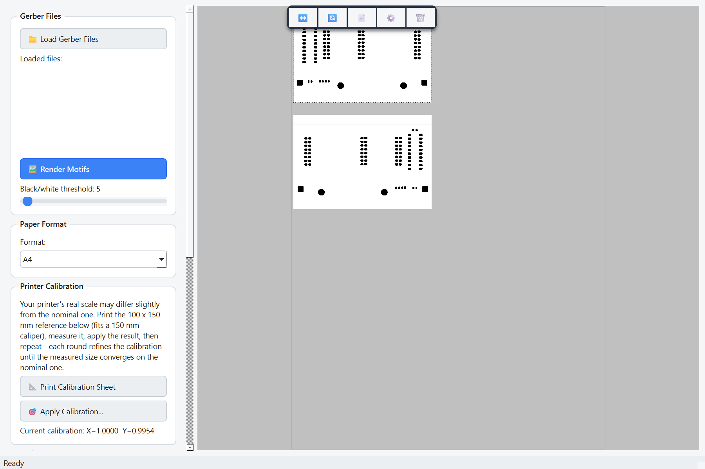
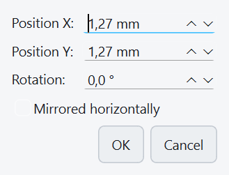
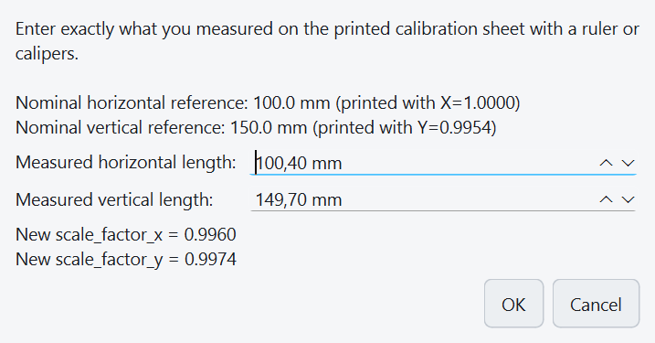

# GerberMaskPrint

**PCB Mask Print from KiCad** — print solder masks from Gerber files at a precise 1:1 scale on a regular printer.

**Status:** Beta



## Description

This tool loads Gerber files exported from KiCad and prints them at an exact 1:1 scale on A4/A3/Letter/Legal paper. It's primarily intended for producing solder masks via toner transfer, or for checking PCB dimensions before manufacturing.

### Key features

- **Load Gerber files** (X3 format) - standard output from KiCad
- **Precise 1:1 scale** - 37 mm in the Gerber file = 37 mm on paper
- **High resolution** - 1200 DPI for a sharp output
- **Live threshold slider** - adjust the black/white threshold for different kinds of Gerber files (0-255, default 5)
- **Motif editing** - mirror, rotate by 90°, duplicate, and reorder (bring to front / send to back)
- **Right-click context menu and a floating selection toolbar** for quick access to common actions
- **Properties dialog** - fine-tune a motif's X/Y position (in mm), rotation, and mirroring precisely
- **Printer calibration tool** - print a reference sheet, measure it, and refine the scale correction iteratively
- **Zoom** - mouse wheel or buttons to check details
- **Reusable motifs** - add the same rendered motif to the page as many times as needed
- **Multiple paper formats** - A4, A3, Letter, Legal
- **Export to PDF and BMP**, plus direct 1:1 printing

## Installation

### Requirements

- Python 3.13+
- PySide6 6.10.0
- pygerber 2.4.3
- Pillow 10.4.0
- PyMuPDF

### Installing dependencies

```bash
pip install -r requirements.txt
```

### First-time setup

Copy the example settings file and adjust it if needed:

```bash
cp settings.example.json settings.json
```

`settings.json` is not tracked by git (see [Printer calibration](#printer-calibration) below) - it stores your last-used Gerber folder and your printer's calibration factors, and each user's copy is expected to be different.

## Usage

```bash
python gerber_mask_print.py
```

### Try it with the sample board

No KiCad project handy? [`examples/sample_board/`](examples/sample_board) contains a small synthetic 40 x 30 mm test board (`sample-Edge_Cuts.gbr` + `sample-F_Mask.gbr`) you can load right away via "Load Gerber Files" to try out the whole workflow before pointing the app at your own Gerbers.

### Workflow

1. **Load a Gerber file** - "Load Gerber Files" button
   - Generate Gerbers in KiCad: File → Fabrication Outputs → Gerbers
   - Select e.g. `*-F_Mask.gbr` (top solder mask)

2. **Adjust the threshold** (if needed)
   - The 0-255 slider changes the black/white threshold
   - The default value of 5 works for most files
   - Live preview - changes are recalculated automatically after you stop dragging

3. **Add the motif to the page**
   - "Add Motif to Page" places the rendered motif on the canvas
   - Drag it into position with the mouse; Ctrl+click to select multiple motifs
   - The same motif can be added and reused multiple times
   - Right-click a motif (or use the floating toolbar that appears above a selection) for Mirror, Rotate 90°, Duplicate, Bring to Front/Send to Back, Properties, and Delete
   - Use "Properties..." to set an exact X/Y position in mm, a precise rotation angle, or toggle mirroring - values update live as you type

   

4. **Print at 1:1 scale**
   - "Print" button
   - Check the print preview
   - Measure the output with calipers to verify

## Printer calibration

Printers rarely output at exactly the scale they claim, so `settings.json` (copied from `settings.example.json`, see above) holds two calibration factors:

```json
{"scale_factor_x": 1.0, "scale_factor_y": 1.0}
```

Rather than guessing and hand-editing this file, use the built-in calibration tool in the "Printer Calibration" panel:

1. **"Print Calibration Sheet"** prints a 100 x 150 mm reference rectangle (fits end-to-end within a standard 150 mm caliper) centered on the page, with a 10 mm grid, using whatever calibration is currently saved.
2. Measure the top and left edges of the printed rectangle with a ruler or calipers.
3. **"Apply Calibration..."** lets you enter the measured values and shows the resulting correction live before saving.

   

4. The correction is folded into the current calibration multiplicatively (`new_scale = current_scale × nominal ÷ measured`), not reset from scratch - print the sheet again with the refined calibration and repeat until the measured size converges on the nominal 100 x 150 mm.

## Technical details

### Rendering pipeline

1. **Gerber parsing** - pygerber Project API (GerberX3)
2. **Rasterization** - 1200 DPI (47 dpmm after rounding)
3. **Threshold filter** - grayscale → threshold → invert
4. **Output** - RGB PNG with inverted colors (black motif on a white background)

### Scale accuracy

- **Input**: Gerber bounding box (e.g. 37.191 × 33.000 mm)
- **Calculation**: width_px = 37.191 mm × 47 dpmm = 1748 px
- **Printing**: target_width = 1748 px × 25.4 mm/inch ÷ printer_dpi
- **Result**: 1:1 scale with an accuracy of ~0.5% (due to dpmm rounding) before per-printer calibration is applied

### Supported formats

- **Paper**: A4 (210×297 mm), A3 (297×420 mm), Letter (216×279 mm), Legal (216×356 mm)
- **Gerber**: X3 format (standard KiCad 9.0+ output)

## Troubleshooting

### Yellow/gray output instead of black
- Adjust the threshold slider on the left - lower the value for a darker output
- The default value of 5 is optimal for most Gerber files

### Dimensions don't match when printing
- Check the printer DPI in the debug output (console)
- Some printers scale automatically - disable "fit to page" in the print dialog
- Use the [printer calibration](#printer-calibration) tool to measure and correct the error instead of hand-editing `settings.json`

### PermissionError when loading
- The application closes files automatically - if the error persists, restart the app

## Version history

- **v1.3 (beta)** - Renamed to GerberMaskPrint; built-in printer calibration tool (print reference sheet, measure, iteratively refine); removed the unused PDF-based variant; MIT license
- **v1.2** - Modernized UI (light theme), motif rotation/duplication/z-order, right-click context menu, floating selection toolbar, motif properties dialog, debounced threshold slider, page-format switch no longer clears placed motifs
- **v1.1** - Added motif mirroring (horizontal flip)
- **v1.0** - Gerber rendering with pygerber, threshold slider, zoom, 1:1 printing

## Author

Built for precise printing of solder masks from KiCad Gerber files.

## License

[MIT](LICENSE)
